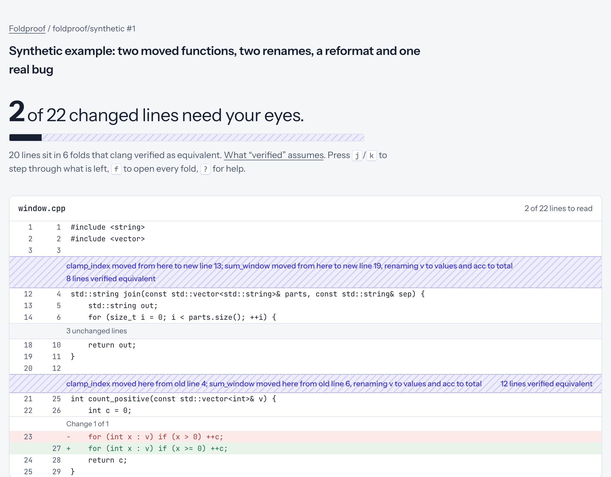

# Foldproof

A diff viewer for AI-written C++ pull requests that only hides what clang can verify.

Coding agents bury the lines that matter under renamed locals, moved functions and reformatting. Foldproof folds that churn away, but only when an independent libclang checker shows that the file you review and the file in the PR mean the same thing. Anything it cannot verify stays in front of you, with the reason it was not folded.



**On 85 agent-authored pull requests it leaves 15,342 of 18,283 changed lines to read, fewer than `git diff -w` (15,569) or difftastic (15,851), and every line it hides was verified. On 649 generated near-miss edits (plus 198 safe refactors), compiled and run, it hid zero behaviour changes.**

To see it: `cd app && npm install && npm run dev`, then open localhost:3000. The five precomputed PRs (four real agent PRs from Claude Code, Codex, Copilot and Cursor, one synthetic) need no C++ build.

## Results

### Real agent PRs

85 agent-authored PRs sampled from the [AIDev](https://huggingface.co/datasets/hao-li/AIDev) dataset (C++ repositories, stratified by agent), 415 modified C++ files (406 analysed; 9 files over 5,000 lines fall back to a plain diff and are excluded from every row), analysed with no include paths (`eval/results.md`):

| Method | Lines left to read | Verified? |
|---|---:|---|
| Raw diff | 18,283 (100%) | |
| difftastic | 15,851 (86.7%) | no |
| `git diff -w` | 15,569 (85.2%) | no |
| **Foldproof** | **15,342 (83.9%)** | **yes, every fold** |
| `git diff -w --color-moved` | 14,069 (77.0%) | no, moved blocks are only coloured |

What the numbers say, plainly:

* All 1,670 accepted folds were formatting folds. Agents in this sample rarely renamed locals or moved whole free functions; the proposer found one candidate move in the corpus. The remaining gap to `--color-moved` is moved code that nothing checks.
* The most common refusal (102) is a proposed rename of something that is not a local variable, which is correct to refuse.
* `git diff -w` hides every whitespace-only change. In this corpus Foldproof refused 14 inside macro arguments that could be stringified and 6 that would change a `__LINE__` value. These can come from missing headers: an unresolved callee may be a stringizing macro, so it stays visible. Supplying include paths raises yield.
* Median analysis time is 0.69 s per file (p90 4.6 s) in a release build with all cores busy; 20 folds across 4 very large files hit the 30 s budget and stay visible.

### Adversarial suite (does it ever hide a behaviour change?)

`eval/adversary` generates near-miss edits that look mechanical but change behaviour (a rename that captures a global, a reformat that flips `<` to `<=`, whitespace inside a stringified macro argument, a move past an overload or a `#pragma` region, `__COUNTER__` and `__LINE__` order, token pasting, ...) plus genuinely safe refactors. Every case is compiled and, where it builds, run. A fold is false if the program the reviewer sees (the PR with folded hunks reverted) and the real PR program behave differently.

| | Cases | Behaviour changed | Cases with a fold | False folds |
|---|---:|---:|---:|---:|
| Near-miss edits (20 kinds) | 649 | 649 | 395 | **0** |
| Safe refactors (5 kinds) | 198 | 0 | 198 (all fully folded) | **0** |

Near-miss cases still get folds (an unrelated reformat in 60% of them, or safe parts of the edit), while the trap stays visible. Zero false folds in 593 cases with folds, 395 of them near-misses; this bounds the generator, not real code. Per-rule numbers are in `eval/adversary/results.txt`. An earlier run found one false fold (a swap of two functions was proposed as moving the one that did not read `__LINE__`); the fix and a generator rule for it are in the history.

## What gets folded, and what never does

| Fold | Folded when | Never folded |
|---|---|---|
| Formatting | Token streams identical; comments equal after whitespace normalisation | Whitespace changes inside `#define`, `#pragma` and other directives where spacing can matter, inside arguments of macros (or unresolved callees) that could stringify them, inside `#if`-disabled code, or anywhere a `__LINE__` observer would move |
| Local rename | Every use of the variable resolves to the same local declaration in both files; no other name changes meaning; overloaded operators and user-defined literals resolve to the same functions | Globals, members, types; functions with compiler errors or directives; functions using a macro whose any definition (active or `#if`-disabled) stringizes, pastes, or mentions the old or new name |
| Move | Free, non-template function relocated in the same namespace; every reference in the file still resolves to the same declaration | Moves across any preprocessor directive, moves of code that reads its own line number, moves when `__COUNTER__` is used, templates and methods |

A fold is accepted only together with every other fold in the file: the final check runs on the fully reverted file, so folds can never combine into a change no single check saw.

## How it works

```
old.cpp ─┐                                   ┌─ residual diff (you read this)
         ├─ Myers line diff ─ tree-sitter ───┤
new.cpp ─┘      (hunks)        proposer      └─ candidate folds
                                                   │
                         R = new with candidate folds reverted
                                                   │
                     libclang: is R equivalent to new? (tokens, bindings, USRs)
                                                   │
                            accept jointly, bisect on failure, report refusals
```

* **Proposer** (`engine/src/proposer.cpp`): tree-sitter only suggests folds. It is never trusted.
* **Checker** (`engine/src/{format,rename,move}_check.cpp`): libclang tokens, `clang_annotateTokens` cursor bindings and USRs. Locals are compared by alpha-equivalence (canonical first-occurrence index), other names by declaration identity, macros transitively through every definition.
* **Analyzer** (`engine/src/analyzer.cpp`): builds the reviewed file R and accepts the largest set of folds it can verify jointly, using bisection when the all-at-once check fails.
* **Viewer** (`app/`): Next.js. Folds render as pleated bands that say what was folded and, when opened, what was checked.

## Assumptions

Verified equivalent means equivalent under these assumptions; the viewer links to the same list.

* Line numbers observed only through header macros such as `assert` are not behaviour. Line numbers observed by `__LINE__`, `__builtin_LINE`, `source_location` or macros defined in the file are checked.
* The file is analysed alone with `-std=c++20`. Project `-D` flags, include paths and generated headers are unknown; missing headers cause parse errors, and renames or moves are only folded in functions clang parsed cleanly.
* Nothing outside the file is checked. A move cannot change another translation unit, but ODR violations elsewhere are out of scope.

## How it was built

Each stage was implemented, tested under ASan and UBSan, reviewed by an independent adversarial agent with no shared context, fixed, and committed on its own. Reviewers found 16 soundness holes and 15 other bugs across the checkers, analyzer and viewer (for example `/**/ #define`, digraph `%:` directives, `assert` stringizing a renamed variable, a move into a `#pragma clang attribute` region, operator overloads changing after a move, a headline that ignored non-C++ files). Each engine finding became a regression test before its stage was committed; `git log` shows the trail.

## Run it

```sh
cmake --preset release && cmake --build --preset release
./build/release/foldproof analyze --old old.cpp --new new.cpp [-I include]   # JSON on stdout

cmake --preset asan && cmake --build --preset asan && ctest --preset asan   # tests

cd app && npm install && npm run dev        # viewer on localhost:3000; demos need no engine
                                            # live analysis of a PR's C++ files needs the release build
python3 eval/adversary/run.py               # adversarial suite (compiles and runs every case)
python3 eval/prepare_aidev.py && python3 eval/fetch_corpus.py && python3 eval/run_corpus.py   # real agent PRs
```

Requires macOS with Homebrew LLVM (`/opt/homebrew/opt/llvm`, override with `-DLLVM_PREFIX` and `LLVM_PREFIX`), CMake 3.24+, Node 20+, `gh` for fetching PRs, and for the evaluation Python 3 with `pyarrow` and difftastic (`difft`).

Demo PRs contain unmodified code from their projects under their own licences; see [docs/DEMO_SOURCES.md](docs/DEMO_SOURCES.md). Foldproof itself is MIT licensed.

## Limitations

* C++ only, one file at a time, macOS SDK headers by default.
* Moves of methods, templates and out-of-line definitions are not folded yet; neither are renames of structured bindings.
* Yield on real code is bounded by missing build context. Supplying include paths (`-I`) raises it.
* The user study is not done: the next step is timed reviews of PRs with planted bugs, with and without folds.
